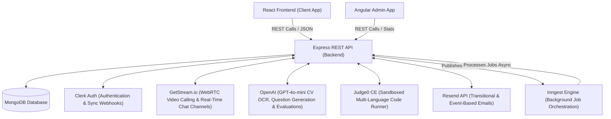
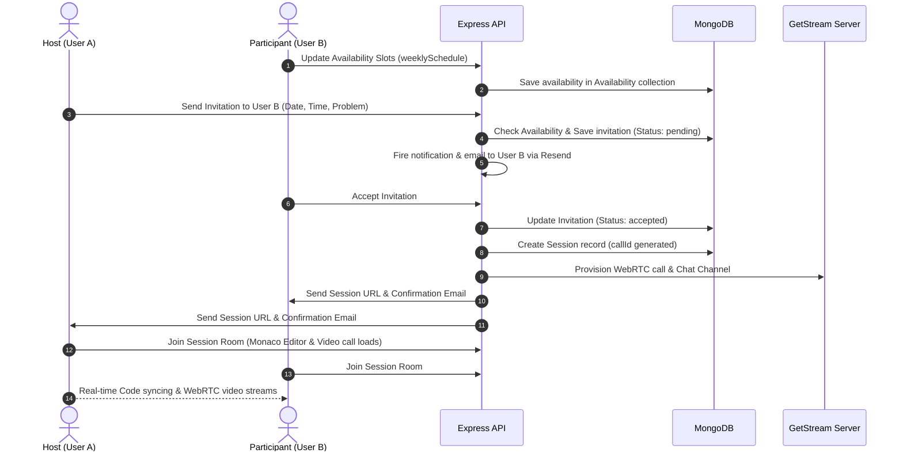
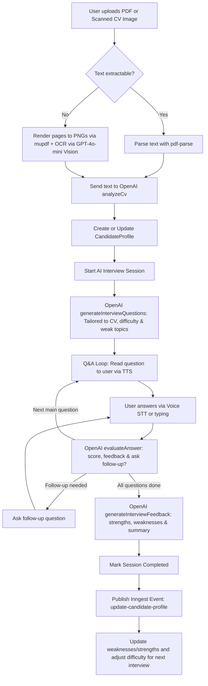

# Provelt System Architecture & Technical Analysis Report

Welcome! This report provides a detailed, end-to-end analysis of **Provelt**, a collaborative peer-to-peer coding platform and adaptive AI-driven mock interview system. This project is structured as a monorepo containing three core packages:

1. **`backend`**: Node.js & Express REST API, MongoDB/Mongoose database layer, Inngest background event processing, and OpenAI integrations.
2. **`frontend`**: React 19 web application built with Vite, Tailwind CSS v4, Monaco Editor, and GetStream Video & Chat SDKs.
3. **`admin`**: Angular v17 dashboard built with Tailwind CSS v3 and DaisyUI v5 for user analytics, live tracking, and admin statistics.

---

## 1. System Architecture Overview

Provelt integrates multiple external services and frameworks to power its collaborative and AI features. The diagram below illustrates how client applications interact with the central backend server and external providers:

---

## 2. Core Cycles & Detailed Workflows

Provelt is divided into three distinct operational cycles: **Peer-to-Peer Collaborative Coding**, **Adaptive AI Mock Interviews**, and **Subscription & Quota Management**.

### A. Peer-to-Peer Collaborative Coding Cycle

This feature enables developers to practice coding interviews together in real-time. It handles scheduling, availability checks, audio/video conferencing, and a real-time collaborative code editor.

#### Detailed Steps:
1. **Availability Scheduling**: Users set their timezone-based weekly schedule in [AvailabilitySettingsPage.jsx](file:///d:/ITI_MEARN/FinalProject/Provelt-Final-main/frontend/src/pages/AvailabilitySettingsPage.jsx). The backend in [availabilityController.js](file:///d:/ITI_MEARN/FinalProject/Provelt-Final-main/backend/src/controllers/availabilityController.js) validates and saves slots in the [Availability.js](file:///d:/ITI_MEARN/FinalProject/Provelt-Final-main/backend/src/models/Availability.js) schema.
2. **Invitations**: When User A invites User B via [SchedulePage.jsx](file:///d:/ITI_MEARN/FinalProject/Provelt-Final-main/frontend/src/pages/SchedulePage.jsx), the backend verifies that the selected time falls within the recipient's active availability slots. It saves a pending [Invitation.js](file:///d:/ITI_MEARN/FinalProject/Provelt-Final-main/backend/src/models/Invitation.js) document, logs a [Notification.js](file:///d:/ITI_MEARN/FinalProject/Provelt-Final-main/backend/src/models/Notification.js) record, and sends a Resend email invitation.
3. **Session Provisioning**: Once accepted in [invitationController.js](file:///d:/ITI_MEARN/FinalProject/Provelt-Final-main/backend/src/controllers/invitationController.js), the server:
   - Creates a [Session.js](file:///d:/ITI_MEARN/FinalProject/Provelt-Final-main/backend/src/models/Session.js) entry with an active state.
   - Calls the GetStream Video client (`streamClient.video.call("default", callId)`) to initialize WebRTC.
   - Creates a GetStream messaging channel with both users as members.
   - Emails join links to both participants.
4. **Live Execution & Sync**: In [SessionPage.jsx](file:///d:/ITI_MEARN/FinalProject/Provelt-Final-main/frontend/src/pages/SessionPage.jsx), Monaco Editor is loaded alongside Stream video streams. Code updates are synchronized using custom events broadcasted over the Stream messaging channel. Codes are executed in a sandboxed runner inside [codeController.js](file:///d:/ITI_MEARN/FinalProject/Provelt-Final-main/backend/src/controllers/codeController.js), which invokes **Judge0 CE** (supporting Node.js, Python, and Java).

---

### B. Adaptive AI Mock Interview Cycle

This feature provides voice/text-based conversational technical interviews evaluated by AI. The interview questions adapt to the candidate's CV and prior performance weaknesses.

#### Detailed Steps:
1. **CV Processing**: Uploaded PDFs are parsed in [aiInterviewController.js](file:///d:/ITI_MEARN/FinalProject/Provelt-Final-main/backend/src/controllers/aiInterviewController.js). 
   - If the PDF has an text layer, `pdf-parse` extracts it.
   - If scanned or image-based, `mupdf` renders the pages into high-resolution PNG buffers in-memory. The image buffers are sent to GPT-4o-mini vision (`analyzeCvFromImages`) for OCR analysis.
   - The parsed properties (primary field, skills, experience, summary) are upserted into [CandidateProfile.js](file:///d:/ITI_MEARN/FinalProject/Provelt-Final-main/backend/src/models/CandidateProfile.js).
2. **Adaptive Questions Generation**: When the interview begins, `generateInterviewQuestions` (in [openai.js](file:///d:/ITI_MEARN/FinalProject/Provelt-Final-main/backend/src/lib/openai.js)) prepares 5–7 conversational questions in English or Arabic. It retrieves the user's previously recorded `topicWeaknesses` and inserts more questions testing those specific areas.
3. **Voice/Text Q&A Interaction**: In [InterviewPage.jsx](file:///d:/ITI_MEARN/FinalProject/Provelt-Final-main/frontend/src/pages/InterviewPage.jsx), the Web Speech Synthesis API reads questions aloud. The candidate answers using Web Speech Recognition (auto-submitting on silence detection) or by typing.
4. **Grading & Dynamic Follow-up**: Each answer is evaluated by GPT (`evaluateAnswer`) which returns a score (1–10) and specific feedback. If the score is borderline (4–6) and lacks detail, OpenAI triggers a follow-up flag, prompting the user for clarification before proceeding to the next main question.
5. **Scorecard & Background Profiling**: After completing the questions, the overall scorecard is generated with overall feedback, strengths, and weaknesses. The session status is set to `completed`, and an Inngest background event (`ai-interview/completed`) is published:
   - Inside [inngest.js](file:///d:/ITI_MEARN/FinalProject/Provelt-Final-main/backend/src/lib/inngest.js), the worker calculates the average score.
   - Topics with scores below 6 are logged as `topicWeaknesses`.
   - Topics with scores above 7 are logged as `topicStrengths`, resolving any prior weakness counters.
   - If the average session score is low (< 5), the user's profile difficulty is set to `easy`. If high (> 7), it increases to `hard`.

---

### C. Subscription & Quota Management Cycle

Controls access to AI features based on billing tiers:

* **Free Plan**: Access is limited to **3 AI interviews per month**.
* **Pro & Premium Plans**: Access is **unlimited**.

#### Quota Enforcement Workflow:
1. When starting an interview, the server invokes `checkAndConsumeInterviewQuota` in [aiInterviewController.js](file:///d:/ITI_MEARN/FinalProject/Provelt-Final-main/backend/src/controllers/aiInterviewController.js).
2. If the user's billing period has ended, their monthly count is reset to 0, and the billing window is updated.
3. If they are on the Free plan and have reached 3 interviews, the request is rejected with a `402 Payment Required` status, prompts an upgrade, and redirects to [PricingPage.jsx](file:///d:/ITI_MEARN/FinalProject/Provelt-Final-main/frontend/src/pages/PricingPage.jsx).
4. Subscriptions are managed in [subscriptionController.js](file:///d:/ITI_MEARN/FinalProject/Provelt-Final-main/backend/src/controllers/subscriptionController.js). A card payment simulation processes test cards (approving Visa/Mastercard and declining cards ending in `0000`), activates the upgraded plan, updates the limits in [Subscription.js](file:///d:/ITI_MEARN/FinalProject/Provelt-Final-main/backend/src/models/Subscription.js), and sends an email receipt via Resend.

---

## 3. Technology Stack & Ecosystem Details

The tables below detail the packages, developer services, and client libraries used in the Provelt project:

### Backend Services & Dependencies
| Technology / Library | Role & Integration | Path Reference |
| :--- | :--- | :--- |
| **Node.js (ES Modules)** | Server runtime with support for modern import/export syntax. | [package.json](file:///d:/ITI_MEARN/FinalProject/Provelt-Final-main/backend/package.json) |
| **Express v5** | Web framework handling routes, CORS policies, global error handling, and JSON payloads. | [server.js](file:///d:/ITI_MEARN/FinalProject/Provelt-Final-main/backend/src/server.js) |
| **MongoDB / Mongoose** | NoSQL database storing user metadata, profiles, scheduled slots, sessions, and scorecard logs. | [db.js](file:///d:/ITI_MEARN/FinalProject/Provelt-Final-main/backend/src/lib/db.js) |
| **Clerk Express Middleware** | Intercepts HTTP headers to authenticate requests and populates `req.auth` context. | [server.js](file:///d:/ITI_MEARN/FinalProject/Provelt-Final-main/backend/src/server.js#L32) |
| **Inngest SDK** | Handles asynchronous background job flows (e.g., Clerk user synchronization, adaptive profiling). | [inngest.js](file:///d:/ITI_MEARN/FinalProject/Provelt-Final-main/backend/src/lib/inngest.js) |
| **OpenAI Node Client** | Connects to GPT models for parsing CVs, rendering vision analysis, generating questions, and scoring. | [openai.js](file:///d:/ITI_MEARN/FinalProject/Provelt-Final-main/backend/src/lib/openai.js) |
| **GetStream Node SDK** | Server-side credential signing and room/channel configuration. | [stream.js](file:///d:/ITI_MEARN/FinalProject/Provelt-Final-main/backend/src/lib/stream.js) |
| **Resend Node Client** | Connects to the Resend transactional email API. | [email.js](file:///d:/ITI_MEARN/FinalProject/Provelt-Final-main/backend/src/lib/email.js) |
| **MuPDF (WebAssembly)** | Extracts content from image-based PDFs without requiring native OS canvas libraries. | [aiInterviewController.js](file:///d:/ITI_MEARN/FinalProject/Provelt-Final-main/backend/src/controllers/aiInterviewController.js#L27-L54) |
| **pdf-parse** | Extracts text layers from standard digital PDFs. | [aiInterviewController.js](file:///d:/ITI_MEARN/FinalProject/Provelt-Final-main/backend/src/controllers/aiInterviewController.js#L78) |

### Frontend (React Core & Styling)
| Library | Purpose | Path Reference |
| :--- | :--- | :--- |
| **React 19** | Component-driven frontend framework. | [package.json](file:///d:/ITI_MEARN/FinalProject/Provelt-Final-main/frontend/package.json) |
| **Vite** | Frontend tooling and dev server. | [vite.config.js](file:///d:/ITI_MEARN/FinalProject/Provelt-Final-main/frontend/vite.config.js) |
| **React Router v7** | Handles application routing and navigation state guards. | [App.jsx](file:///d:/ITI_MEARN/FinalProject/Provelt-Final-main/frontend/src/App.jsx) |
| **Tailwind CSS v4** | CSS utility system for modern UI styling. | [index.css](file:///d:/ITI_MEARN/FinalProject/Provelt-Final-main/frontend/src/index.css) |
| **DaisyUI v5** | Component library providing dark mode styling and UI elements. | [package.json](file:///d:/ITI_MEARN/FinalProject/Provelt-Final-main/frontend/package.json#L21) |
| **Monaco Editor React** | The code editor interface used in peer-to-peer session rooms. | [CodeEditorPanel.jsx](file:///d:/ITI_MEARN/FinalProject/Provelt-Final-main/frontend/src/components/CodeEditorPanel.jsx) |
| **Stream Video React SDK** | Audio/video component bindings for real-time WebRTC streams. | [SessionPage.jsx](file:///d:/ITI_MEARN/FinalProject/Provelt-Final-main/frontend/src/pages/SessionPage.jsx#L22) |
| **Stream Chat React SDK** | Chat panel components and message feed channels. | [VideoCallUI.jsx](file:///d:/ITI_MEARN/FinalProject/Provelt-Final-main/frontend/src/components/VideoCallUI.jsx) |
| **TanStack React Query** | Cache synchronization and asynchronous data mutations. | [main.jsx](file:///d:/ITI_MEARN/FinalProject/Provelt-Final-main/frontend/src/main.jsx) |
| **React Resizable Panels** | Draggable split-pane layout containing code editor, console outputs, and chat feeds. | [SessionPage.jsx](file:///d:/ITI_MEARN/FinalProject/Provelt-Final-main/frontend/src/pages/SessionPage.jsx#L13) |

### Admin Dashboard (Angular Stack)
| Technology / Library | Purpose & Implementation | Path Reference |
| :--- | :--- | :--- |
| **Angular v17** | Core framework for the administrative client app. | [package.json](file:///d:/ITI_MEARN/FinalProject/Provelt-Final-main/admin/package.json) |
| **Clerk JS SDK** | Standalone auth library for admin session protection. | [package.json](file:///d:/ITI_MEARN/FinalProject/Provelt-Final-main/admin/package.json#L20) |
| **Tailwind CSS v3** | Styling utility library for admin layouts. | [tailwind.config.js](file:///d:/ITI_MEARN/FinalProject/Provelt-Final-main/admin/tailwind.config.js) |
| **Chart.js / ng2-charts** | Renders analytics charts showing interview completions and subscription distribution. | [dashboard.component.ts](file:///d:/ITI_MEARN/FinalProject/Provelt-Final-main/admin/src/app/pages/dashboard/dashboard.component.ts) |

---

## 4. Architectural Highlights & Best Practices

1. **Robust Error Handling**: The API uses a global unhandled exception middleware inside [server.js](file:///d:/ITI_MEARN/FinalProject/Provelt-Final-main/backend/src/server.js#L65-L68) to prevent server crashes and restrict error stack leaks to client applications.
2. **Reliable Clerk Webhooks**: Authentication synchronization is managed via Clerk events (`user.created` / `user.deleted`) handled asynchronously using Inngest workers. This decouples database operations from user login actions.
3. **Resilient Integrations**: If external API keys (like Resend) are missing, the server logs warning alerts and bypasses the action rather than interrupting the workflow (e.g., accepting invitations will still run without email notifications).
4. **Adaptive AI Profiling**: Storing topic strengths and weaknesses as a key-value structure directly inside [CandidateProfile.js](file:///d:/ITI_MEARN/FinalProject/Provelt-Final-main/backend/src/models/CandidateProfile.js) allows the OpenAI generation prompts to focus on a developer's weak spots, providing a personalized interview experience.
